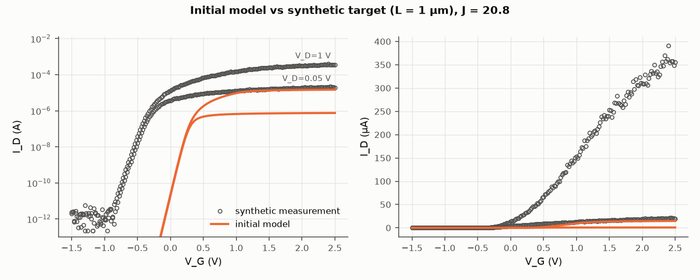
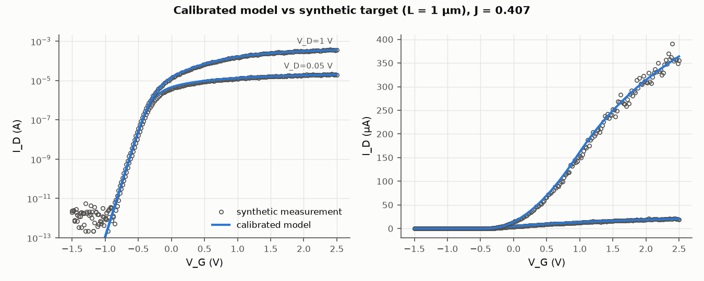
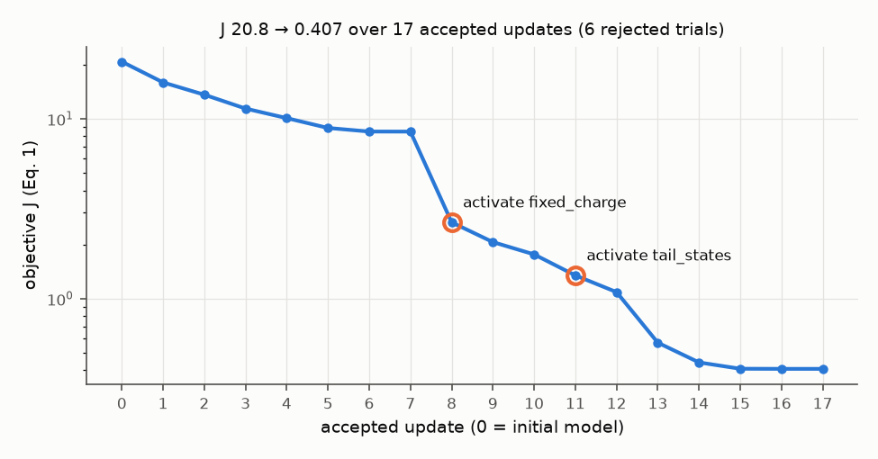
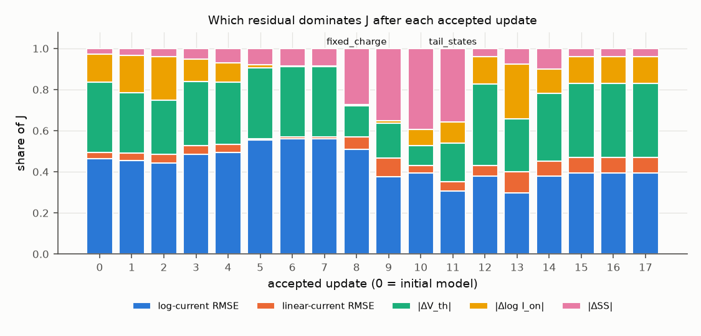
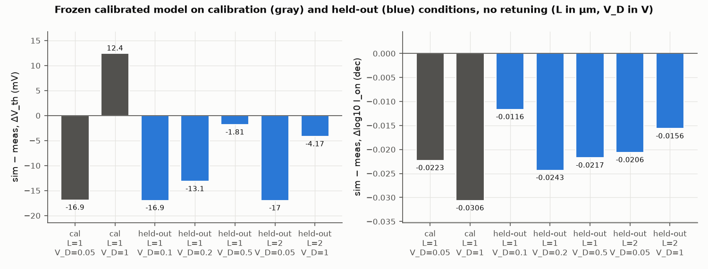

# Agentic TCAD Calibration: Reproducible Open Demo

This repository is an **open, paper-inspired demonstration** of a residual-guided, bounded, tool-using
calibration workflow for oxide-semiconductor transistors. It runs a complete calibration cycle on
**synthetic data** with a small analytic device model. It needs no TCAD license, no private data, and no
paid API. It is a **synthetic-data reproduction of the calibration workflow, not a reproduction of the
paper's measured-device or Sentaurus results.**

> **Paper:** G. Jeong *et al.*, "Agentic TCAD Calibration Workflow for Oxide Semiconductor Transistors,"
> arXiv:2609.12184 (v2), 2026. <https://arxiv.org/abs/2609.12184> · DOI
> [10.48550/arXiv.2609.12184](https://doi.org/10.48550/arXiv.2609.12184)

## What the demo shows

| Concept from the paper | What runs here |
|---|---|
| Measured-vs-simulated I<sub>D</sub>–V<sub>G</sub> residuals and device metrics | V<sub>th</sub> at 100 nA, SS over 0.1–100 nA, I<sub>on</sub> = max \|I<sub>D</sub>\|, 10 pA floor |
| Multi-metric objective J (Eq. 1) | Same five terms and the paper's weights (0.25 / 0.10 / 1.00 / 0.20 / 0.25) |
| OFAT sensitivity and bounded DFO-GN update (Eq. 2–3) | Finite-difference Jacobian from simulator probes, then a box- and trust-radius-constrained Gauss–Newton step |
| Accept only converged updates that reduce J | Enforced by the controller, and every rejection is logged with its reason |
| Residual-guided physics-model activation | A fixed-charge term and a tail-state term, activated only when a residual persists and, to first order, the existing parameters cannot remove it (or the controlling parameter is pinned at its bound), and only after an approval record |
| Fixed-model transfer tests | Held-out drain biases (0.1, 0.2, 0.5 V) and a second channel length (2 µm), with no retuning |
| LLM agent orchestrating tools | Default: a deterministic, inspectable rule-based controller. Optional: an LLM planner using the same tools and rules |

The **agent** (controller or LLM) only *chooses* among legal actions. It probes a parameter group,
requests a model activation, or stops. The numerical step always comes from the Gauss–Newton tool, and
J alone decides acceptance.

## Quick start

Tested with Python 3.10, 3.11, and 3.12 on Linux. It runs on a laptop CPU in about 5 s.
`requirements-lock.txt` pins the exact versions of the reference run (Python 3.11). On 3.10 or 3.12,
use `pip install -e ".[dev]"` instead.

```bash
git clone <this repository> agentic-TCAD-calibration-public
cd agentic-TCAD-calibration-public
python -m venv .venv && source .venv/bin/activate
pip install -r requirements-lock.txt && pip install -e . --no-deps
python -m agentic_tcad_demo run --config configs/synthetic_demo.yaml
pytest
```

The run writes these files to `outputs/demo/`:
- `action_log.jsonl`: every observation, diagnosis, OFAT ranking, proposal, trial, decision, approval, and stop
- `summary.json`
- `final_params.yaml`
- five figures

The figures below were produced by exactly this command.

## Example results (synthetic data, seed 2609)

| | Value from this run |
|---|---|
| Objective J, initial → final | 20.77 → 0.407 (17 accepted updates, 6 rejected trials) |
| Model activations | `fixed_charge` (gate work function railed at its bound), then `tail_states` (persistent ΔSS that no active parameter could reach) |
| Stop reason | parameter updates stalled (relative gain below 1%) and no further component was eligible |
| Calibration conditions (L = 1 µm, V<sub>D</sub> = 0.05, 1 V) | max \|ΔV<sub>th</sub>\| 16.9 mV, max \|Δlog I<sub>on</sub>\| 0.031 dec |
| Held-out drain bias (V<sub>D</sub> = 0.1, 0.2, 0.5 V) | max \|ΔV<sub>th</sub>\| 16.9 mV, max \|Δlog I<sub>on</sub>\| 0.024 dec |
| Held-out channel length (L = 2 µm) | max \|ΔV<sub>th</sub>\| 17.0 mV, max \|Δlog I<sub>on</sub>\| 0.021 dec |
| Other noise seeds (2600–2609) | final J 0.34–0.43 (median 0.375), both components activated every time, held-out max \|ΔV<sub>th</sub>\| 17.0–22.9 mV (median 19.6). Seed 2609 is on the favorable side, and 6 of the 10 seeds stop at the 25-update cap instead of stalling |

The synthetic "measurement" contains physics the calibration model lacks: a gate-dependent mobility and a
drain-induced threshold shift. The fit therefore cannot be perfect. The remaining V<sub>th</sub> errors,
from −17 to +12 mV, are model-form error, not noise. They are already present on the calibration
conditions. They stay at 14–19 mV with the noise switched off, and fall to about 3 mV when the extra truth
physics is removed.

The held-out drain biases lie between the two calibration biases, so that test is an interpolation in
V<sub>D</sub>. The L = 2 µm test changes the geometry.

The two candidate components use the same functional forms as the synthetic truth. The meaningful check is
therefore the negative one. If the truth lacks a component, the workflow does not activate it
(`test_activation_gate_is_selective`).

| | |
|---|---|
|  |  |
|  |  |



## Paper vs. this public demo

| | Paper (arXiv:2609.12184) | This repository |
|---|---|---|
| Device data | Fabricated bottom-gate In–W–O TFT, measured I<sub>D</sub>–V<sub>G</sub> | Synthetic curves from an analytic "truth" model with noise (fixed seed) |
| Solver | Synopsys Sentaurus Device (2D, drift-diffusion) | Closed-form charge-based compact model with self-consistent contact resistance |
| Agent | GPT-5.5 via Codex and the NeMo Agent Toolkit, with RAG and a human reviewer | Deterministic rule controller (default), optional LLM planner, policy-file or interactive approval |
| Parameters | Calibrated effective TCAD descriptors (published in the paper) | Illustrative values only, deliberately different from the paper's |
| Result | J 2.589 → 0.181 (14.3×), transfer errors ≤ 46.2 mV | J 20.77 → 0.407 on synthetic data. Not comparable, because the J normalization and the data differ. |
| Shared | Residual-guided, bounded, J-gated, tool-using calibration with model activation and no-retune evaluation | Same |

More detail is in [`docs/paper_vs_demo.md`](docs/paper_vs_demo.md) and [`docs/methodology.md`](docs/methodology.md).
The paper does not specify some details: the normalization factors a<sub>i</sub>, the bounds, the trust
radius, the solver, and the stopping rule. Every value used here is listed as a demo choice in the config.

## Why this is relevant

TCAD calibration is an expensive inverse problem. Several physical models and parameter sets can explain
the same transfer curve. This demo makes the paper's control logic concrete and testable, and the same
pattern applies to agentic scientific computing, inverse problems with costly simulators, and
physics-based digital twins:
- residuals choose what to probe
- bounded local updates
- model classes added only when the evidence demands it
- strict acceptance on a fixed objective
- evaluation on held-out conditions

The toy model is a teaching instrument. A good synthetic calibration says nothing about industrial TCAD
accuracy. The value here is the inspectable workflow, its guard rails, and its tests.

## Optional extensions

- **LLM planner.** Set `AGENTIC_TCAD_LLM_BASE_URL`, `AGENTIC_TCAD_LLM_MODEL`, and optionally
  `AGENTIC_TCAD_LLM_API_KEY` (see `.env.example`), then run with `--planner llm`. The planner works with
  any OpenAI-compatible endpoint, hosted or local. The LLM may only choose legal actions. Invalid output
  is logged as a planner error. The run never silently falls back to the rule planner.
- **Your own simulator.** Implement the small `Simulator` interface and point the config at it. See
  [`docs/private_simulator.md`](docs/private_simulator.md). Keep any proprietary adapter, deck, or
  license configuration outside this repository.
- **Human review.** `--interactive` asks on the terminal before each model activation.

## Notes

The published study used Synopsys Sentaurus. This repository contains no Synopsys software,
documentation, examples, or input decks. It is not affiliated with or endorsed by Synopsys, or by any
other vendor named in the paper.

**License:** [MIT](LICENSE) for the code in this repository. The paper itself is distributed by arXiv
under CC BY 4.0. Please cite it when you use the method.

## Citation

See [`CITATION.cff`](CITATION.cff). Please cite the paper for the method:

```bibtex
@misc{jeong2026agentic,
  title  = {Agentic {TCAD} Calibration Workflow for Oxide Semiconductor Transistors},
  author = {Jeong, Gyujun and Lee, Junmo and Cho, Sungwon and Hwang, Woohyun and Seo, Kwangyou and
            Lim, Suhwan and Kim, Wanki and Ha, Daewon and Ranade, Rishi and Youn, Kihang and
            Cherukuri, Ram and Wang, Yiyi and Khan, Asif and Yu, Shimeng},
  year   = {2026},
  eprint = {2609.12184},
  archivePrefix = {arXiv},
  doi    = {10.48550/arXiv.2609.12184}
}
```
